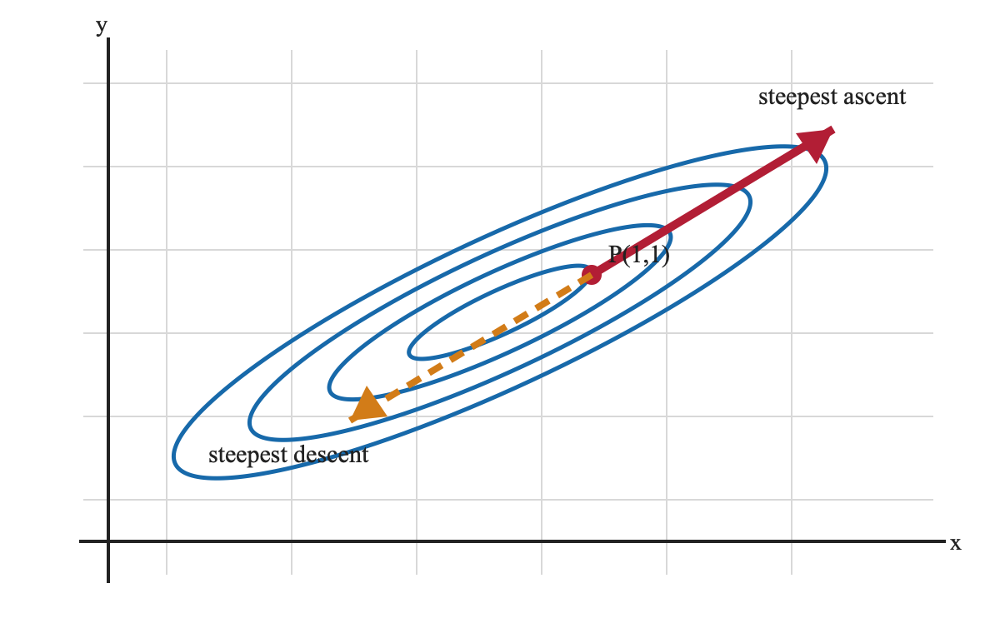
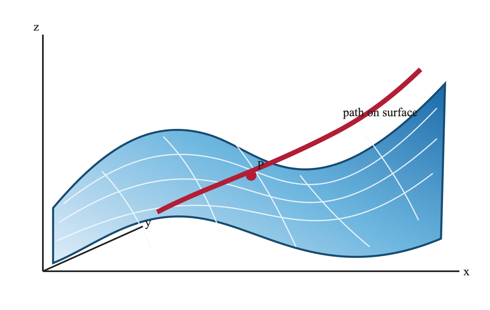

---
lmx:
  schema: 1
  theme: hcmut-report-v1
  structure:
    cover: true
    toc: true
    tocDepth: 3
    listOfFigures: true
    listOfTables: true
  cover:
    university: ĐẠI HỌC QUỐC GIA THÀNH PHỐ HỒ CHÍ MINH
    school: TRƯỜNG ĐẠI HỌC BÁCH KHOA
    faculty: KHOA KHOA HỌC VÀ KỸ THUẬT MÁY TÍNH
    reportType: BÀI TẬP LỚN GIẢI TÍCH 2
    title: TÌM ĐƯỜNG ĐI CÓ ĐỘ DỐC LỚN NHẤT
    major: KHOA HỌC MÁY TÍNH
    council: NHÓM 01
    supervisor: "Nguyễn Văn A"
    secretary: "-"
    students:
      - name: Nguyễn Văn An
        id: "2210001"
      - name: Trần Thị Bình
        id: "2210002"
    locationDate: TP. HỒ CHÍ MINH, 2026
  header:
    enabled: true
    institution: Trường Đại Học Bách Khoa - Đại học Quốc gia TP.HCM
    faculty: KHOA KHOA HỌC VÀ KỸ THUẬT MÁY TÍNH
  footer:
    enabled: true
    left: Bài tập lớn Giải tích 2 - HK232
    pageNumber: current-total
---

:::cover
:::

:::toc
:::

:::list-of-figures
:::

:::list-of-tables
:::

# Tóm tắt

Báo cáo trình bày cơ sở lý thuyết về đạo hàm theo hướng và vector gradient,
sau đó áp dụng để xác định đường đi mà độ cao của một mặt cong tăng nhanh
nhất hoặc giảm nhanh nhất. Một thuật toán số và chương trình Python được đưa
ra để người dùng nhập hàm số hai biến và điểm khảo sát trên mặt cong.

**Đề bài tham chiếu:** Đề 1 trong tài liệu `BTL_HK232.pdf`.

# Cơ sở lý thuyết

## Đạo hàm theo hướng

Cho hàm số khả vi $f(x,y)$ và vector đơn vị $u=(u_1,u_2)$.
Đạo hàm theo hướng của $f$ tại $P=(x_0,y_0)$ theo hướng $u$ là

$$
D_{u}f(P)=\lim_{h\to 0}\frac{f(P+hu)-f(P)}{h}.
$$

Nếu $f$ khả vi tại $P$, ta có công thức

$$
D_{u}f(P)=\nabla f(P)\cdot u.
$$

:::theorem {#thm-gradient-direction title="Định lý đạo hàm theo hướng"}
Nếu $f$ khả vi tại $P$, giá trị lớn nhất của $D_{u}f(P)$ trên mọi
vector đơn vị đạt được khi $u$ cùng hướng với $\nabla f(P)$ và bằng
$\lVert\nabla f(P)\rVert$. Giá trị nhỏ nhất đạt được khi $u$ ngược
hướng với gradient và bằng $-\lVert\nabla f(P)\rVert$.
:::

## Vector gradient

Vector gradient của hàm hai biến được định nghĩa bởi

$$
\nabla f(x,y)=\left(\frac{\partial f}{\partial x},
\frac{\partial f}{\partial y}\right).
$$

Gradient vuông góc với đường mức $f(x,y)=c$. Vì vậy, tại một điểm trên mặt
địa hình, gradient chỉ hướng dốc lên nhanh nhất; hướng đối diện là hướng dốc
xuống nhanh nhất.

:::property {#prop-level-set-gradient}
Tại mọi điểm mà $\nabla f(P)\ne\mathbf{0}$, vector gradient vuông góc với
đường mức đi qua $P$.
:::

## Liên hệ với mặt cong

Xét mặt cong $z=f(x,y)$ và một đường đi trên mặt phẳng $Oxy$ có tham số
$(x(t),y(t))$. Độ cao dọc theo đường đi là

$$
z(t)=f(x(t),y(t)),\qquad
\frac{dz}{dt}=\nabla f(x(t),y(t))\cdot(x'(t),y'(t)).
$$

Do đó, khi vector tiếp tuyến $(x'(t),y'(t))$ là vector đơn vị cùng hướng với
gradient, tốc độ tăng độ cao là lớn nhất.

# Đường đi dốc nhất của một hàm hai biến

## Định nghĩa

Đường đi dốc nhất đi lên tại $P$ là đường cong trong mặt phẳng $Oxy$ có tiếp
tuyến tại mỗi điểm cùng hướng với $\nabla f$. Đường đi dốc nhất đi xuống có
tiếp tuyến ngược hướng với gradient.

Nếu gradient không bằng không, phương trình vi phân của đường đi đi lên là

$$
\frac{d\mathbf{r}}{ds}=\frac{\nabla f(\mathbf{r}(s))}
{\lVert\nabla f(\mathbf{r}(s))\rVert},
\qquad \mathbf{r}(0)=(x_0,y_0).
$$

Trong trường hợp cần đường đi theo một hướng cố định tại điểm khảo sát, ta
có thể dùng tiếp tuyến $\nabla f(x_0,y_0)$ để dựng xấp xỉ tuyến tính.

## Ví dụ tính toán

Chọn hàm số

$$
f(x,y)=x^2-y^2+\frac{1}{2}xy
$$

và điểm $P=(1,1,f(1,1))=(1,1,\frac{1}{2})$. Khi đó

$$
\nabla f(x,y)=\left(2x+\frac{1}{2}y,-2y+\frac{1}{2}x\right),
\qquad \nabla f(1,1)=\left(\frac{5}{2},-\frac{3}{2}\right).
$$

Vector chỉ phương của đường đi dốc nhất đi lên là $(5,-3)$, nên đường đi
tuyến tính tại $P$ có phương trình

$$
y-1=-\frac{3}{5}(x-1).
$$

Đường đi dốc nhất đi xuống có vector chỉ phương $(-5,3)$ và cùng đường thẳng
tiếp tuyến nhưng đi theo chiều ngược lại.

:::proposition {#prop-steepest-value title="Tốc độ tăng lớn nhất tại điểm khảo sát"}
Với ví dụ trên, tốc độ tăng lớn nhất theo khoảng cách nằm ngang là
$\lVert\nabla f(1,1)\rVert=\sqrt{\frac{25}{4}+\frac{9}{4}}=\sqrt{\frac{17}{2}}$.
:::

# Thuật toán và chương trình

## Thuật toán

1. Nhận biểu thức $f(x,y)$ và tọa độ $(x_0,y_0)$ từ người dùng.
2. Tính hai đạo hàm riêng $f_x$ và $f_y$.
3. Tính gradient tại $(x_0,y_0)$.
4. Chuẩn hóa gradient để nhận vector hướng đi lên; đổi dấu để nhận hướng đi xuống.
5. Vẽ đường mức trong một hình chữ nhật quanh $(x_0,y_0)$.
6. Vẽ mặt cong $z=f(x,y)$ và đường đi tương ứng trên mặt cong.

:::listing {#lst-steepest-code caption="Mã Python xác định hướng dốc nhất" language="python" lineNumbers=true}
```python
import sympy as sp
import numpy as np
import matplotlib.pyplot as plt

x, y = sp.symbols("x y", real=True)
expr = input("Nhap f(x,y): ")
f = sp.sympify(expr)
x0 = float(input("Nhap x0: "))
y0 = float(input("Nhap y0: "))

fx = sp.diff(f, x)
fy = sp.diff(f, y)
gx = float(fx.subs({x: x0, y: y0}))
gy = float(fy.subs({x: x0, y: y0}))
norm = np.hypot(gx, gy)
if norm == 0:
    raise ValueError("Gradient bang 0: khong co huong doc duy nhat.")

u = np.array([gx, gy]) / norm
print("Huong di len:", u)
print("Huong di xuong:", -u)
```
:::

## Kiểm soát dữ liệu

Chương trình chỉ nhận các biểu thức khả vi trên miền khảo sát. Nếu gradient tại
điểm nhập bằng vector không, chương trình phải thông báo rằng không thể chọn
một hướng dốc duy nhất bằng tiêu chuẩn gradient. Người dùng cũng cần kiểm tra
điểm $(x_0,y_0,z_0)$ có thỏa $z_0=f(x_0,y_0)$ hay không.

# Kết quả minh họa

Với $f(x,y)=x^2-y^2+0.5xy$ và $P=(1,1,0.5)$, các đại lượng chính thu được là:

:::table {#tbl-steepest-results caption="Kết quả tính tại điểm P" placement="h!"}
| Đại lượng             | Giá trị                   |
| --------------------- | -------------------------:|
| $f(1,1)$              | $0.5$                     |
| $f_x(1,1)$            | $2.5$                     |
| $f_y(1,1)$            | $-1.5$                    |
| Độ lớn gradient       | $\sqrt{8.5}\approx 2.915$ |
| Vector hướng đi lên   | $(5,-3)/\sqrt{34}$        |
| Vector hướng đi xuống | $(-5,3)/\sqrt{34}$        |
:::

Đường mức gần điểm $P$ là các đường cong $f(x,y)=c$. Tiếp tuyến của đường
đi dốc nhất cắt các đường mức gần như vuông góc. Trên mặt cong, đường đi đi
lên tương ứng với việc tăng $z$ nhanh nhất theo chiều dài cung của hình chiếu
trên $Oxy$.

|     |     |
| --- | --- |
|     |     |

:::figure {#fig-contour caption="Bản đồ mức và hướng dốc nhất tại P" placement="h!" width=0.78}

:::

:::figure {#fig-surface caption="Mặt cong và đường đi dốc nhất minh họa" placement="h!" width=0.78}

:::

:::exercise {#ex-steepest-check title="Bài tập kiểm tra"}
Với $g(x,y)=x^2+2y^2-xy$ tại $Q=(1,-1)$, hãy tính $\nabla g(Q)$, vector hướng
đi lên và tốc độ tăng lớn nhất.
:::

# Kết luận

Đạo hàm theo hướng và gradient cung cấp một tiêu chuẩn trực tiếp để tìm hướng
đi lên hoặc đi xuống nhanh nhất của mặt cong. Quy trình tính toán gồm bước
phân tích đạo hàm, chuẩn hóa vector gradient, kiểm tra dữ liệu và trực quan hóa
đồng thời bản đồ mức với mặt cong. Cách biểu diễn này đáp ứng các yêu cầu lý
thuyết, thuật toán, code và ví dụ của Đề 1 trong tài liệu bài tập lớn.

# Tài liệu tham khảo

1. Soo T. Tan, *Multivariable Calculus*, Brooks/Cole, 2009.
2. Khoa Khoa học và Kỹ thuật Máy tính, *BTL_HK232.pdf*, Đề 1.

##### Võ Nguyễn Hoàng Long

:::theorem {#thm-label}
Định lý Pytago.

Tổng bình phương hai cạnh gốc vông bằng bằng bình phương cạnh huyền
:::

|     |     |
| --- | --- |
|     |     |
|     |     |
|     |     |
